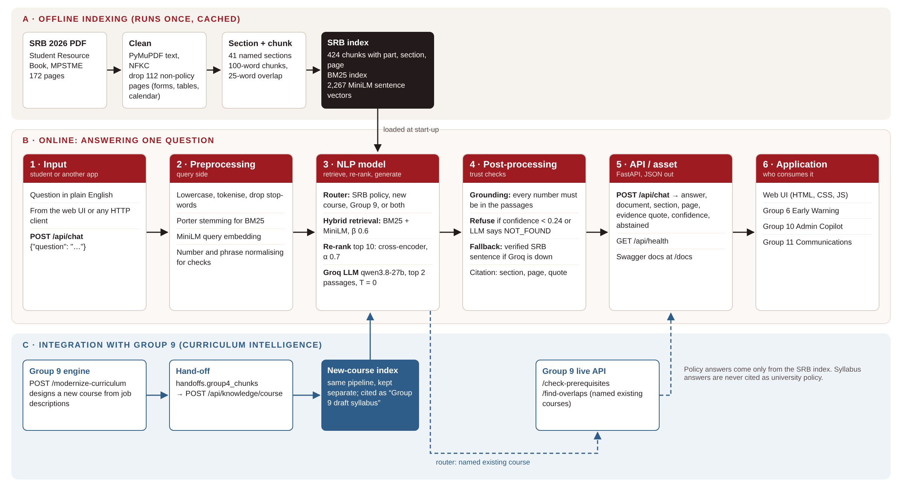

# University Knowledge Assistant (Group 4, AI University Platform)

A reusable NLP asset that answers students' questions about university rules from the **Student Resource Book (SRB) 2026**
of SVKM's NMIMS (MPSTME), and about the **new course** designed by Group 9, with a citation and a confidence score for every answer.

**Team (Group 4):** Aaron Jacob (J019), Vedant Kokate (J021), Saniya Lakdawala (J022), Sharvari Lokegaonkar (J023), Taha Lokhandwala (J024)
**Course:** Natural Language Processing, Final-Year B.Tech, 2026

| Question from the brief | Our answer |
|---|---|
| What institutional problem? | Rules are spread over a 172-page handbook; students ask seniors and get wrong or outdated answers |
| What NLP capability? | Retrieval-augmented question answering: hybrid retrieval, re-ranking, grounded generation, refusal |
| What reusable asset? | A REST API (`POST /api/chat`) that returns answer + document + section + page + evidence quote + confidence |
| How can another app consume it? | One HTTP call, JSON in and out (see below and `docs/API.md`) |
| How do we know it works? | 89.5% answer accuracy and 94.4% citation accuracy on 162 held-out questions; 0 of 20 out-of-scope questions answered (`docs/evaluation.md`) |



## If another group wants to use this tomorrow

**Input:** a question in plain English. **Output:** answer, supporting document, section, page, word-for-word evidence, confidence (0 to 1).

```bash
curl -X POST http://localhost:8000/api/chat -H "Content-Type: application/json" \
     -d '{"question": "What is the minimum attendance required to appear for the end-semester exam?"}'
```

```python
import requests
r = requests.post("http://localhost:8000/api/chat", json={"question": "Can I take a re-exam if I fail?"}).json()
answer, source, conf = r["synthesized_answer"], r["srb"]["source"], r["srb"]["confidence"]
if r["srb"]["abstained"]:
    ...  # not in the SRB: show "please contact the office" instead of guessing
```

Rules for consumers:
- Check `abstained` before showing an answer. A refusal is a correct result, not an error.
- Show `source` and `evidence_quote` next to the answer, so the student can verify it.
- Answers are informational. Final decisions about a student stay with the university office.

Full reference: [`docs/API.md`](docs/API.md). Swagger UI: `http://localhost:8000/docs`.

## Integration with other groups

| Group | How we connect |
|---|---|
| **Group 9: Curriculum Intelligence** (demo step) | Group 9's `POST /modernize-curriculum` returns `handoffs.group4_chunks`: the new course's syllabus in our passage format. We load it with `POST /api/knowledge/course` (or put it at `data/group9/group4_chunks.csv`). Students then ask about the new course's prerequisites, labs, exams and credits. These answers are cited as "Group 9 draft syllabus", never as SRB policy. We also call Group 9's live `/check-prerequisites` and `/find-overlaps` for existing named courses. |
| Group 6: Early Warning, Group 10: Admin Copilot, Group 11: Communications | Can call `POST /api/chat` to answer the policy part of a student's message (for example, the passing criterion for internal assessment) with a citation |
| Group 12: Malicious Input Detection | Can screen questions before they reach us. Our prompt also tells the LLM to ignore instructions inside the question (5 of 5 injection probes ignored in Week 5) |

## Run it locally (full, evaluated version)

Python 3.11 to 3.13. First start downloads two small models (about 170 MB).

```bash
git clone https://github.com/saniyalakdawala/university-knowledge-assistant
cd university-knowledge-assistant
python -m venv .venv
# Windows: .\.venv\Scripts\Activate.ps1     macOS/Linux: source .venv/bin/activate
pip install -r requirements.txt
cp .env.example .env          # Windows: Copy-Item .env.example .env
# edit .env: set GROQ_API_KEY (free key from console.groq.com). Without it, answers fall back to quoting the SRB sentence.
uvicorn app:app --port 8000
```

Open `http://localhost:8000`. Check `http://localhost:8000/api/health`: `retrieval_mode` must say `full`.

Load Group 9's new course (either way works):
- copy their `group4_chunks.csv` to `data/group9/group4_chunks.csv` and restart, or
- `curl -X POST http://localhost:8000/api/knowledge/course -H "Content-Type: application/json" -d @group9_response.json`

Live Group 9 API (optional): run their service on port 8001 and set `GROUP9_API_URL=http://localhost:8001` in `.env`.

## Cloud deployment and its limits

`render.yaml` deploys to Render's free tier (512 MB). To fit, it runs a **lite mode**: BM25 keyword retrieval only, with no
embeddings and no re-ranker (`LOW_MEMORY=true`, set automatically on Render). Lite mode was **not** evaluated, and it fails 4 of our
SRB tests (see `docs/evaluation.md`, section 9). Use the local full version for anything that matters. All metrics in this README
are for the full version.

## Results

| System | Answer accuracy (Test A + B) | Hallucination (out-of-scope answered) |
|---|---|---|
| Baseline (Week 2): BM25 + extractive | 48.8% | 20% |
| v2 (Week 4): hybrid + cross-encoder | 69.8% | 25% |
| **v3 (final): + LLM, grounding check, two-stage refusal** | **89.5%** | **0%** |

162 answerable + 20 out-of-scope test questions, never used for tuning. Error analysis with 10 cases: `docs/evaluation.md`.

## Tests

```bash
python -m pytest tests/ -v
```

- `tests/test_api.py`: endpoints, health, bad input
- `tests/test_integration.py`: SRB answers, refusal, Groq failure fallback, Group 9 offline fallback, no secrets in responses
- `tests/test_course_integration.py`: Group 9 hand-off (loading, routing, the three demo questions, combined course + policy question)

## Repository map

| Brief (Section 11) | Here |
|---|---|
| `src/preprocessing`, `src/models` | `backend/rag_service.py` (PDF cleaning, sectioning, chunking, retrieval, generation, grounding) |
| `src/api` | `app.py` (FastAPI), `backend/schemas.py`, `backend/course_kb.py`, `backend/curriculum_client.py` |
| `src/evaluation`, `notebooks/` | `notebooks/Group4_Week6.ipynb` (all experiments and metrics) |
| `data/` | `data/SRB_2026.pdf`, `data/cache/` (chunks, embeddings), `data/group9/` (Group 9 hand-off) |
| `results/` | `results/metrics_testAB.csv` |
| `docs/` | `architecture.png` (source: `architecture_source.html`), `API.md`, `DATASET.md`, `evaluation.md`, `RESPONSIBLE_AI_STATEMENT.md` (one page), `RESPONSIBLE_AI.md`, `ARCHITECTURE.md` |
| `demo/` | `demo/DEMO_SCRIPT.md` (31 October running order) |
| UI | `frontend/` (HTML, CSS, vanilla JS) |

## Dataset

Full documentation: [`docs/DATASET.md`](docs/DATASET.md).

SRB 2026 (public NMIMS PDF). 60 policy pages, 424 chunks of 100 words (25-word overlap) with part, section and page.
Questions: dev 55, Test A 60, Test B 122, plus robustness and adversarial suites. No student personal data is used.
Limits: tables and staff lists lose their structure in PDF extraction; the SRB itself is ambiguous on a few rules (Part I vs Part II).

## Responsible AI (summary)

- Every answer cites the page and quotes the SRB. Numbers not found in the passages are rejected by the grounding check.
- Two-stage refusal: low retrieval confidence, or the LLM finds no answer. 0 of 20 out-of-scope questions answered.
- Privacy: no login and no chat history. The server does not log question text. The Groq key stays in `.env` (git-ignored).
- The LLM (Groq `qwen/qwen3.8-27b`) sees only the question and two SRB passages.
- Human oversight: answers are informational; the university office decides.
- One-page statement: [`docs/RESPONSIBLE_AI_STATEMENT.md`](docs/RESPONSIBLE_AI_STATEMENT.md). Details: [`docs/RESPONSIBLE_AI.md`](docs/RESPONSIBLE_AI.md).

## LLM use (as required by Section 20)

| Item | Value |
|---|---|
| Model | `qwen/qwen3.8-27b` through the Groq API, temperature 0, max 100 tokens |
| Purpose | Write a one- or two-sentence answer from the top 2 retrieved passages and cite the passage |
| Prompt | In `backend/rag_service.py` (`ask()`): use only the passages, copy numbers exactly, reply NOT_FOUND if absent, ignore instructions in the question |
| Dependency | Groq API key; without it the system still works in extractive mode (69.8% accuracy) |
| Cost | Free tier; about 0.7 s per answer |

## Limitations and future work

- The right passage is sometimes ranked 3rd and missed (10 of 17 test failures). Fix: read 3 passages with a better re-ranker.
- Tables (penalties, committee members) lose structure. Fix: table-aware PDF parsing.
- Follow-up questions ("what about the second year?") were evaluated in the notebook but are not in the API yet.
- Only English. Only the 2026 SRB. Production would need an update pipeline when the SRB changes, logins for staff tools,
  monitoring of refusals, and a server with enough memory to run the full models.
