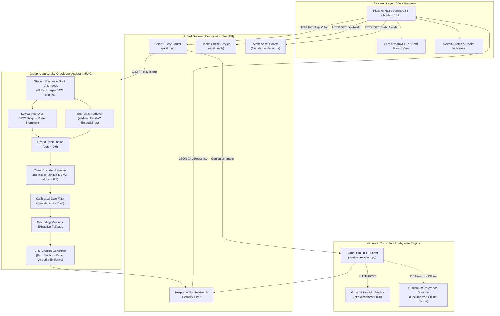

# Group 4 × Group 9 Architecture & Integration Specification

**Component:** Group 4 (University Knowledge Assistant) × Group 9 (Curriculum Intelligence Engine)  
**System:** AI University Application  
**Target Release:** Week 7 Integration Demo (October 2026)

---

## 1. High-Level Architecture Overview

The system bridges the **Student Resource Book (SRB) 2026** knowledge base (Group 4) with the **Curriculum Intelligence Engine** (Group 9), offering a unified entry point for university students and curriculum committee members. 

Students can ask:
1. **University Policy & General Guidelines:** Rules, attendance requirements, examination policies, passing standards (ATKT), fee refunds, code of conduct, and disciplinary policies directly verified from SRB 2026.
2. **Curriculum Intelligence:** Course prerequisite trees, syllabus overlaps, Bloom's taxonomy mapping, and emerging topic coverage.
3. **Cross-Group Inquiries:** Hybrid questions that combine curriculum selection with administrative/university rules (e.g., taking an advanced course like Machine Learning and understanding the prerequisite requirements alongside the mandatory attendance and grading regulations).

---

## 2. Mermaid System Architecture Diagram

---

## 3. Data Flow and Component Interactions

### 3.1 Step-by-Step Request Lifecycle
1. **Student Query Entry:**
   The student enters a question via the browser (e.g., *"What are the prerequisites for Machine Learning, and what is the minimum attendance required?"*).
2. **Intent Analysis & Route Dispatch:**
   `determine_route()` in `app.py` examines the query tokens:
   - Contains curriculum tokens (*"machine learning"*, *"prerequisites"*) -> Flag `curriculum`.
   - Contains policy tokens (*"attendance"*, *"minimum"*) -> Flag `srb`.
   - Both flagged -> Route set to `both`.
3. **Group 4 RAG Execution:**
   - **Lexical Search:** BM25 retrieves top matching passages using Porter-stemmed tokens and stop-word filtering.
   - **Semantic Search:** `sentence-transformers/all-MiniLM-L6-v2` queries the cached sentence-level embeddings.
   - **Hybrid Fusion:** Combines scores using $\beta = 0.6$.
   - **Cross-Encoder Reranking:** Top passages are reranked via `cross-encoder/ms-marco-MiniLM-L-6-v2` ($\alpha = 0.7$).
   - **Confidence Gating:** If retrieval confidence $< 0.46$, the system abstains with `NOT_FOUND` ("I could not find this in the Student Resource Book.").
   - **Grounding Verification:** Numbers and percentages in any generated text must strictly match the passage; otherwise, it falls back immediately to the verified verbatim sentence.
   - **Citation Assembly:** Attaches part, section name, PDF page number, and verbatim evidence quote.
4. **Group 9 Curriculum Client Execution:**
   - Client sends structured JSON payload to Group 9's documented endpoint (`/check-prerequisites`, `/find-overlaps`, or `/compare-curricula`).
   - If Group 9's local server is live, the live engine output is returned with `connected=True`.
   - If the endpoint is unreachable or times out, the client falls back to the documented reference stand-in cache, returning `is_fallback=True` with a transparent advisory message.
5. **Synthesis & Response Delivery:**
   `app.py` synthesizes the response, strictly isolating verified official university policy from curriculum advisory intelligence. The client UI renders both cards with clear badges and evidence callouts.

---

## 4. Cold-Start and Resource Optimization

1. **Precomputed Chunk and Embedding Cache:**
   On initial boot, the application parses `SRB_2026.pdf` (424 chunks, 1,514 sentences), computes sentence embeddings with `all-MiniLM-L6-v2`, and serializes the resulting structures to:
   - `data/cache/chunks.pkl` (276 KB)
   - `data/cache/sent_emb.npy` (2.3 MB)
   On subsequent reloads, these structures load from disk in **under 0.3 seconds**, preventing redundant PyMuPDF parsing and embedding computation.
2. **Single-Process Lightweight Server:**
   The entire application runs as a single FastAPI process using Uvicorn on a unified origin. No frontend build tools, Node runtime, or complex container meshes are required.
